<div align="center">

<picture>
  <source media="(prefers-color-scheme: dark)" srcset=".github/assets/banner-dark.svg">
  
</picture>

**Exercise your HTTP application without opening a socket.**<br>
In-memory requests and fluent response assertions for applications built with `pushinbr/pam-http`.

[](https://packagist.org/packages/pushinbr/pam-http-testing)

[](https://github.com/push-in/pam-http-testing/actions/workflows/ci.yml)
[](LICENSE)

[Install](#install) · [Quick example](#quick-example) · [API](#api) · [Docs](#docs) · [Issues](https://github.com/push-in/pam-http-testing/issues)

</div>

<a id="install"></a>
## <picture></picture> Install

Projects created with `pam init my-api --template http` already require it as a dev dependency. Elsewhere:

```sh
pam composer require --dev pushinbr/pam-http-testing
pam test
```

<a id="quick-example"></a>
## <picture></picture> Quick example

```php
<?php

declare(strict_types=1);

use Pam\App;
use Pam\Http\Request;
use Pam\Http\Response;
use Pam\Http\Testing\TestClient;
use PHPUnit\Framework\TestCase;

final class ApplicationTest extends TestCase
{
    public function test_ping_endpoint(): void
    {
        $app = new App(discoverPackages: false);
        $app->get('/api/ping', static fn (Request $request, Response $response): Response => $response->json(['message' => 'pong']));

        (new TestClient($app))
            ->get('/api/ping')
            ->assertSuccessful()
            ->assertJson(['message' => 'pong']);
    }
}
```

Run it with `pam test`. The old `Pam\Testing\TestClient` and `Pam\Testing\TestResponse` names remain available as aliases.

<a id="what-you-can-build"></a>
## <picture></picture> What you can build

- Fast controller and middleware tests
- JSON, headers, status, and validation assertions
- Regression suites for routes without network flakiness

| | |
| --- | --- |
| **Role** | Testing toolkit |
| **Execution path** | PHPUnit-compatible in-memory HTTP harness |
| **This repository owns** | Application-level HTTP test ergonomics |
| **Boundary** | Transport, TLS, proxy, and kernel behavior still require integration tests |

<a id="api"></a>
## <picture></picture> API

| Surface | Methods |
| --- | --- |
| `TestClient` | `request()`, `get($target, $headers)`, `postJson($target, $payload, $headers)` |
| `TestResponse` | `assertStatus()`, `assertSuccessful()`, `assertHeader()`, `assertJson()`, `assertJsonPath()`, `header()`, `json()` |

```php
$client = new Pam\Http\Testing\TestClient($app);
$client->get('/users/42')
    ->assertSuccessful()
    ->assertJsonPath('id', '42');
```

<a id="docs"></a>
## <picture></picture> Docs

- [PAM HTTP documentation](https://push-in.github.io/pam-docs/packages/http/)
- [PAM HTTP](https://github.com/push-in/pam-http)
- [Changelog](CHANGELOG.md)

<a id="pam-ecosystem"></a>
## <picture></picture> Part of the PAM ecosystem

PAM runs PHP natively on servers, desktops and phones. This repository is one piece of it.

| [**PAM**](https://github.com/push-in/pam) | [**PAM Desktop**](https://github.com/push-in/pam-desktop) | [**PAM Native**](https://github.com/push-in/pam-native) | [**Ecosystem**](https://github.com/push-in/pam#ecosystem) |
| --- | --- | --- | --- |
| the runtime and CLI | native desktop apps in PHP | native Android and iOS apps in PHP | every official package and plugin |

<sub>Docs: [push-in.github.io/pam-docs](https://push-in.github.io/pam-docs/introduction/) · [Issues](https://github.com/push-in/pam-http-testing/issues)</sub>

<p align="center"><sub><a href="LICENSE">Apache License 2.0</a>: use, modify and distribute for any purpose, including commercially · Made in Brazil by Pushin</sub></p>
